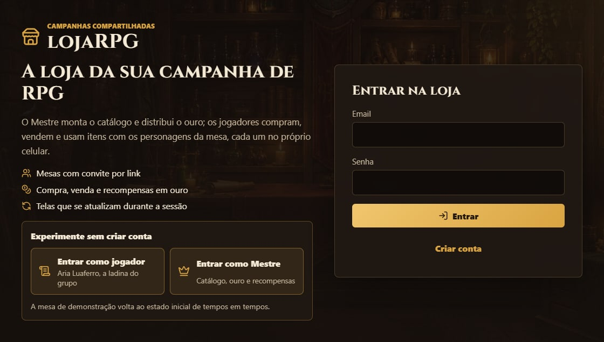
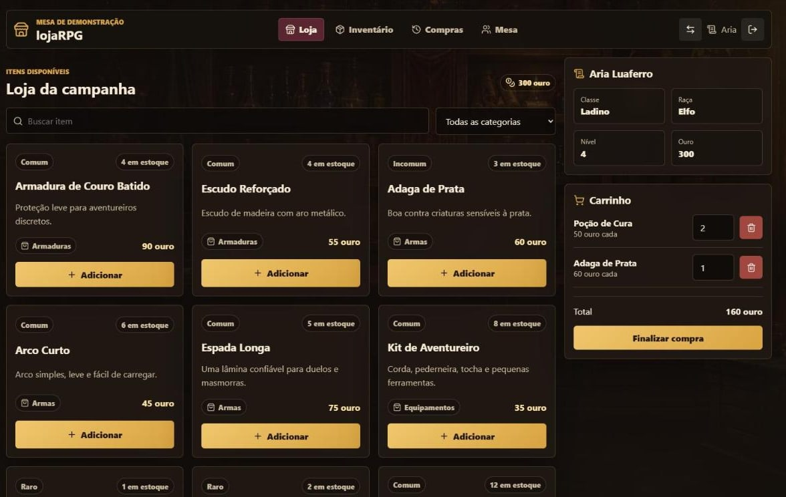
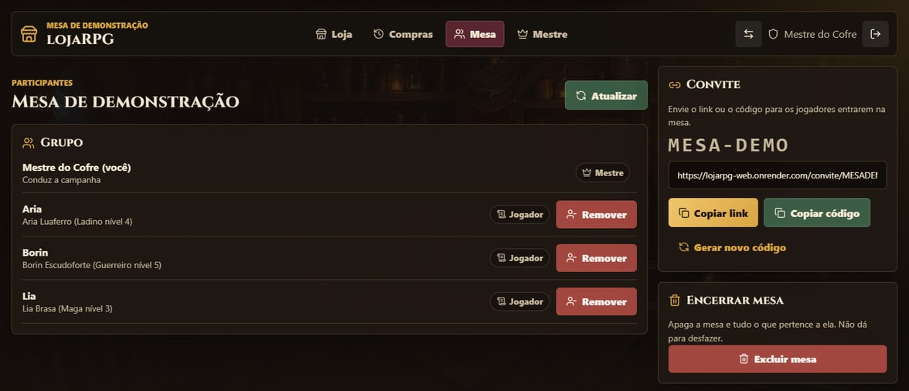
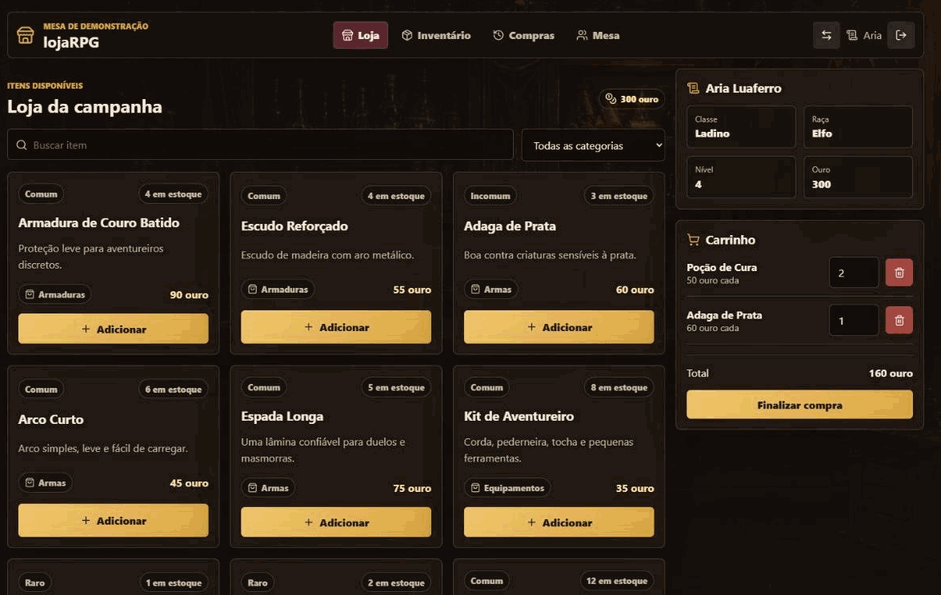
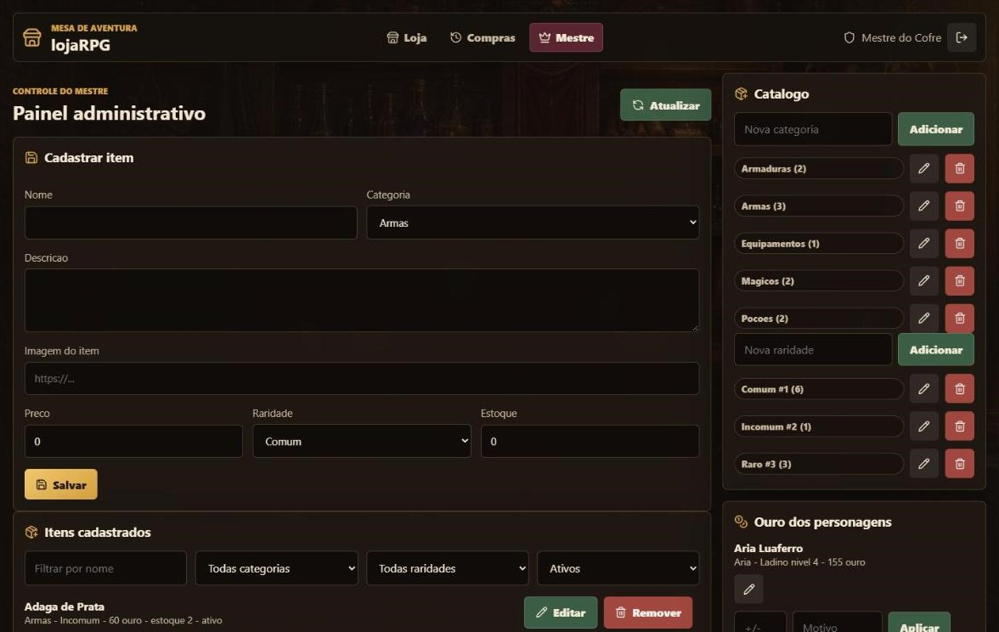
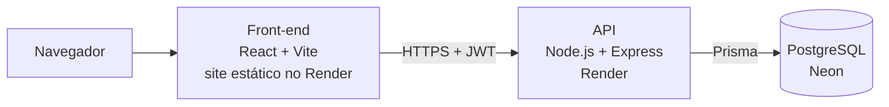

# lojaRPG

[](https://github.com/PedroBartkevihi/lojaRPG/actions/workflows/ci.yml)

Loja virtual para campanhas de RPG de mesa. Cada grupo tem sua mesa: quem
cria a mesa é o Mestre e convida os jogadores por link ou código. O Mestre
administra itens, categorias, raridades, estoque e o ouro dos personagens; os
jogadores criam personagens na mesa, montam o carrinho e compram com o ouro
deles. Catálogo, inventário e histórico de compras são separados por mesa.

**Demonstração online:** <https://lojarpg-web.onrender.com>

Na tela de entrada, os botões **Entrar como jogador** e **Entrar como Mestre**
abrem a mesa de demonstração sem digitar senha. As contas são estas:

| Perfil | Email | Senha |
| --- | --- | --- |
| Jogador | aria@lojarpg.local | jogador123 |
| Mestre | mestre@lojarpg.local | mestre123 |

Essas contas participam da **Mesa de demonstração**, que volta ao estado
inicial sempre que a API reinicia, então pode testar à vontade. Para testar o
convite, crie sua própria conta e entre na mesa com o código `MESA-DEMO`, ou
crie uma mesa e convide alguém. Mesas criadas por outras contas não são
apagadas no reset.

A demonstração roda no plano gratuito do Render: depois de 15 minutos sem
acesso, a API leva cerca de 1 minuto para acordar. Enquanto isso, a tela mostra
blocos de carregamento e avisa que a API está acordando.





## Funcionalidades

**Mesas**

- Qualquer conta cria uma mesa e é o Mestre dela; a mesma conta pode ser
  jogador em outras mesas.
- Convite por link ou código. O Mestre gera um código novo para invalidar o
  anterior e remove jogadores.
- Cada mesa tem catálogo, personagens, compras e históricos próprios, e começa
  com um catálogo de exemplo que o Mestre edita.
- Quem sai ou é removido da mesa mantém os personagens e os recupera ao
  entrar de novo.
- "Esqueci minha senha": um link por e-mail, válido por 30 minutos e uma
  vez, cria a senha nova e encerra as sessões abertas da conta.
- As telas se atualizam sozinhas durante a sessão: o ouro que o Mestre dá ou
  o item que outro jogador compra aparecem sem recarregar a página.
- Moedas do D&D: preços e saldos aparecem em PO, PP e PC, como no livro
  (248 PO 5 PP), e os campos de valor aceitam também PL (1 PL = 10 PO,
  1 PO = 10 PP, 1 PP = 10 PC).
- Diário de sessões: compras, vendas, usos, entregas, recompensas e ajustes
  feitos com uma sessão aberta ficam ligados a ela. Toda a mesa consulta o
  resumo de cada sessão, e os históricos filtram por sessão.

Para jogar com o seu grupo: crie uma conta, crie a mesa e envie o link da aba
**Mesa** aos jogadores. Cada um cria a conta pelo link, entra na mesa e cria o
personagem.



**Jogador**

- Um ou mais personagens por mesa (botão "Novo personagem"), com a escolha
  do personagem ativo.
- Catálogo com busca (que ignora acentos) e filtros por vendedor, categoria,
  raridade e faixa de preço em PO ("até 100 PO"); cada item tem a cor da
  raridade (comum, incomum, raro, muito raro, lendário) e um ícone pela
  categoria.
- App instalável no celular ("Adicionar à tela inicial"), com ícone e tela
  cheia, sem a barra do navegador. Sem modo offline: os dados vêm da API.
- Carrinho e compra com as moedas do personagem ativo, inclusive com itens de
  vendedores diferentes; no celular, uma barra no rodapé leva ao carrinho.
- Venda de itens ao vendedor de origem pela regra do D&D 5e (metade do preço)
  ou pelo valor que o Mestre definir; o item volta ao estoque.
- Uso de itens consumíveis, como poções, que saem do inventário.
- Encomendas ao Mestre: pedir um item que não está no catálogo ("um arco
  élfico, pago até 300 PO") e acompanhar a resposta na própria loja.
- Entrega de itens e moedas a outro personagem da mesa, sem passar pelo
  Mestre; os dois lados ficam registrados no histórico.
- Inventário, histórico de compras e de vendas, usos, entregas e recompensas
  por personagem, com "Mostrar mais" para os registros antigos.



**Mestre**

- Painel em abas: grupo e moedas, vendedores, itens, catálogo e históricos.
- Guia de primeiros passos numa mesa nova (revisar o catálogo, convidar os
  jogadores, esperar os personagens, dar o ouro inicial): cada passo marca
  sozinho pelos dados da mesa, e o guia some quando tudo está feito.
- Vendedores (a mesa começa com o **Geral**), cada um com catálogo, estoque e
  horário de atendimento próprios. O horário é só informativo, no tempo da
  campanha: o Mestre abre e fecha cada vendedor, e um vendedor fechado
  continua visível, mas não compra nem vende.
- Diário: o Mestre inicia e encerra sessões numeradas, com notas.
- Cadastro, edição, remoção e reativação de itens, com a imagem colada como
  URL ou enviada direto do celular (quando o armazenamento de imagens está
  configurado).
- Categorias e raridades próprias, com a cor de cada raridade escolhida pelo
  Mestre; ao remover uma em uso, os itens são realocados.
- Recompensas: moedas divididas entre o grupo (avisando o que sobra da
  divisão) ou o mesmo valor para cada um, e itens entregues direto no
  inventário, inclusive itens que não estão à venda.
- Preço de venda por item e itens que a loja não compra, como itens de missão.
- Encomendas dos jogadores: aprovar entregando um item do catálogo ou um item
  novo, feito para a encomenda, cobrando até o valor que o jogador aceitou
  pagar, ou recusar com uma nota.
- Ajuste de saldo com motivo obrigatório e auditoria de cada alteração.
- Histórico de movimentações de estoque.



## Arquitetura



Na API, cada requisição passa por `routes` → `controllers` (validação com Zod)
→ `services` (regras e transações) → `models` (consultas pelo Prisma). As
rotas da loja ficam abaixo de `/campaigns/:id`, e um middleware confere se quem
pede participa da mesa e qual é o papel dele nela.

## Decisões técnicas

- **Mesas isoladas.** Toda consulta de itens, catálogo, personagens, compras e
  auditoria filtra pela mesa da URL. Quem não participa recebe 404, como se a
  mesa não existisse, e um id de outra mesa (item, personagem, categoria) é
  tratado como inexistente. Testes tentam ler e alterar dados entre mesas.
- **O papel é da mesa, não da conta.** Não existe mais chave de cadastro de
  Mestre: quem cria a mesa é o Mestre dela. Os códigos de convite usam um
  alfabeto sem caracteres ambíguos (0/O, 1/I), e as tentativas de entrar têm
  rate limit.
- **Demonstração e mesas reais no mesmo banco.** As contas de exemplo são
  públicas, então a API não deixa que criem ou entrem em outras mesas (numa
  mesa real, qualquer visitante veria a mesa e o reset apagaria os
  personagens). O reset apaga só a mesa marcada como demonstração e as contas
  de exemplo; se houver dados legados dessas contas em mesas reais, ele para
  antes de excluir qualquer dado. Veja a orientação no DEPLOY.md.
- **Compras e vendas simultâneas sem perder dinheiro nem estoque.** O desconto
  de ouro e de estoque é um update condicional ("só desconta se ainda houver
  saldo"). Compras bloqueiam os itens em ordem de id. Compras e vendas
  bloqueiam primeiro o personagem; se faltar inventário na venda, o crédito
  inteiro é desfeito. As edições do Mestre rodam em transação e só gravam se o valor lido
  não mudou (senão respondem 409). Testes disparam compras, vendas e ajustes ao
  mesmo tempo para garantir isso.
- **Dinheiro inteiro, em peças de cobre.** Banco e API guardam todo valor em
  PC (`BIGINT`), e o front converte para PO e PP só na tela: não há ponto
  flutuante, e metade de 75 PO é 37 PO e 5 PP, sem arredondar. As proporções
  seguem o [SRD 5.1](https://media.wizards.com/2023/downloads/dnd/SRD_CC_v5.1.pdf).
  Uma aba aberta antes da troca de unidade recebe 428 ao gravar, em vez de
  mandar valores em PO para uma API que espera PC.
- **Encomenda aprovada numa transação só.** O status muda primeiro, com o
  mesmo update condicional das outras operações (duas aprovações ao mesmo
  tempo: uma passa, a outra recebe 409), o ouro sai com o débito condicional
  da compra, e a encomenda vira uma compra no histórico e no diário da
  sessão. Se faltar ouro, tudo volta e a encomenda continua pendente. O item
  feito sob medida entra no catálogo fora da loja, sem estoque.
- **Compra e entrega sem cobrança dupla.** Cada compra e cada entrega levam
  uma `idempotencyKey`, gravada na mesma transação da operação. Se a resposta
  se perder e o front repetir o pedido, a API devolve o resultado original em
  vez de cobrar de novo.
- **Regras de integridade no próprio banco.** As migrations têm restrições
  `CHECK` (ouro e estoque nunca negativos, nível de 1 a 20), que valem mesmo
  para código que grave direto no banco.
- **Validação de entrada com Zod**, com schemas por domínio em
  `backend/src/schemas`.
- **Autenticação** com access token curto, refresh token com rotação e
  revogação, rate limit nas rotas de autenticação e Helmet. Atrás do proxy do
  Render, o rate limit usa o IP de cada usuário (`TRUST_PROXY`), e não o do
  proxy, que todos compartilhariam.
- **Atualização por consulta periódica, não por WebSocket.** Com a aba
  visível, o front recarrega os dados a cada 10 segundos; aba escondida não faz
  requisições. Para quatro pessoas numa mesa isso basta, e funciona no plano
  gratuito do Render, que dorme e derrubaria conexões abertas.
- **Primeira impressão no plano gratuito.** Enquanto a API acorda, a tela
  mostra blocos no formato do conteúdo e, depois de 4 segundos, explica a
  demora, em vez de parecer travada.
- **Segredo verificado na inicialização:** em produção, a API não sobe com um
  `JWT_SECRET` curto ou igual aos exemplos do repositório.
- **Senhas novas com pelo menos 8 caracteres** e fora de uma lista local de
  senhas comuns ("12345678", "senha123", repetições como "aaaaaaaa"). A lista
  fica no código, sem consulta a serviço externo. Contas criadas com o mínimo
  antigo (6) continuam entrando até trocar a senha.
- **Cabeçalhos de segurança no site estático.** O `render.yaml` manda
  Content-Security-Policy (só a própria origem, a API, as fontes do Google e
  imagens HTTPS), `X-Content-Type-Options`, `Referrer-Policy`,
  `frame-ancestors 'none'` e HSTS. Os testes de ponta a ponta servem o site
  com esses mesmos cabeçalhos e reprovam se o navegador bloquear algo.
- **Imagens enviadas direto ao armazenamento.** O upload de imagens dos
  itens vai do navegador para o Cloudinary com uma assinatura da API, que
  fixa a pasta da mesa, os formatos aceitos e a redução para 800 px; o segredo
  nunca sai da API, e ela guarda só a URL final, como uma URL colada.
- **PWA só com a casca do app.** O service worker (`vite-plugin-pwa`) guarda
  JS, CSS e ícones, que têm hash no nome; a página vem sempre da rede quando há
  conexão, para um deploy novo não abrir a versão anterior. O registro é um
  arquivo externo, compatível com a CSP.
- **Recuperar senha sem revelar contas.** O pedido responde igual (e no
  mesmo tempo) para e-mail cadastrado ou não, tem limite por IP e no máximo um
  e-mail por minuto para a conta. O token vai no fragmento do link (`#token=`),
  que não chega a servidores nem a logs, fica guardado só como hash, vale 30
  minutos e uma vez. A troca de senha sobe a versão da sessão da conta, que
  vai nos dois tokens: access e refresh tokens emitidos antes dela são
  recusados, mesmo os de um login ou renovação que correu junto com a troca.
- **Refresh token em cookie httpOnly, opcional.** Com `VITE_REFRESH_COOKIE=true`,
  o refresh token sai do `localStorage` e fica num cookie que o JavaScript da
  página não lê (`HttpOnly`, `Path=/auth`, `SameSite`), pedido pelo cabeçalho
  `X-Refresh-Transport: cookie`, que obriga o preflight do CORS. Fica desligado
  na demonstração porque site e API estão em subdomínios do `onrender.com`,
  que contam como sites diferentes; vale com um domínio próprio. Os testes de
  ponta a ponta rodam nos dois modos.
- **Limpeza e limites.** Refresh tokens vencidos ou revogados são apagados
  no início da API e a cada 6 horas, e uma conta mestra no máximo 10 mesas ao
  mesmo tempo (`MAX_CAMPAIGNS_PER_USER`).
- **CI no GitHub Actions** a cada push: lint (ESLint) e testes do back-end
  com PostgreSQL; lint, testes e build do front-end; e testes de ponta a ponta
  com Playwright, que sobem a API, o site de produção e um PostgreSQL e passam
  pelos fluxos principais num Chromium, guardando print, vídeo e trace quando
  algo falha.
- **`/health` e `/ready` separados.** O Render reinicia a API pelo `/health`,
  que só diz que o processo responde; o `/ready` consulta o banco e serve para
  o monitor de disponibilidade. Assim um banco lento não derruba uma API
  saudável.

## Stack

- Front-end: React, Vite e React Router.
- Back-end: Node.js, Express, Zod, JWT (access + refresh token).
- Banco: PostgreSQL com Prisma e migrations versionadas.
- Testes e qualidade: Vitest, Supertest, Testing Library, Playwright e ESLint.
- Infra: Docker Compose, GitHub Actions, Render e Neon.

## Como rodar localmente

Pré-requisitos: Node.js 24 e Docker.

```bash
# Banco (na raiz do projeto)
docker compose up -d db

# API
cd backend
npm install
cp .env.example .env
npx prisma generate
npm run db:reset
npm run dev

# Front-end (em outro terminal)
cd frontend
npm install
cp .env.example .env
npm run dev
```

No Prompt de Comando do Windows, troque `cp` por `copy`; no PowerShell e no
Git Bash, `cp` funciona.

- Front-end: <http://localhost:5173>
- API: <http://localhost:3001>

O container do banco cria o `lojarpg` (desenvolvimento), o `lojarpg_test`
(testes do back-end) e o `lojarpg_e2e` (testes de ponta a ponta). Os usuários de exemplo são os da tabela acima, mais os jogadores
`borin@lojarpg.local` e `lia@lojarpg.local` (senha `jogador123`).

Scripts do diretório `backend`:

- `npm run db:init`: aplica as migrations pendentes.
- `npm run db:seed`: recria a mesa de demonstração e as contas de exemplo de
  `prisma/seed.js`, sem tocar nas outras mesas.
- `npm run db:reset`: apaga o banco local, reaplica as migrations e roda o
  seed.
- `npm run db:backup` e `npm run db:restore-check`: backup do banco e ensaio
  de restauração (veja "Backup e restauração" no DEPLOY.md).

## Testes

```bash
cd backend
npm run lint
npm test

cd frontend
npm run lint
npm test
```

Os testes do back-end usam o banco `lojarpg_test` do Docker: aplicam as
mesmas migrations do desenvolvimento e recriam os dados antes de cada teste.
Por segurança, só rodam em bancos cujo nome termina em `_test`. Eles cobrem
mesas, convites e isolamento entre mesas, autenticação e permissões, CRUD de
itens e catálogo, vendedores, compras, vendas, uso de itens, entregas e
recompensas, compras, vendas e ajustes simultâneos, repetição de compras e
entregas, sessões e paginação dos históricos, validação das entradas, regras
`CHECK` do banco, as migrações de vendedores e de moedas, o reset da
demonstração, a verificação dos segredos de produção e o `/ready`.

### Ponta a ponta (Playwright)

```bash
docker compose up -d db
# Só num volume criado antes desta versão (o container novo já cria o banco):
docker compose exec db psql -U lojarpg -c "CREATE DATABASE lojarpg_e2e"

cd e2e
npm install
npx playwright install chromium
npm test
```

O Playwright sobe sozinho a API (porta 3101, com migrations e a mesa de
demonstração) e o site de produção (`vite build` e `vite preview`, porta 4173)
apontando para o banco `lojarpg_e2e`. Por segurança, só roda em bancos cujo
nome termina em `_e2e` ou `_review` (mude com `E2E_DATABASE_URL`). Sem baixar
o Chromium do Playwright, `E2E_BROWSER_CHANNEL=chrome npm test` usa o Chrome
instalado. Os fluxos: compra (com clique duplo, que não pode cobrar duas
vezes), venda e uso de itens, convite por link com cadastro no caminho,
criação de personagem, recompensa do Mestre aparecendo na tela do jogador, loja
fechada, remoção de jogador e sessão vencida (renovada sem sair da loja, ou
recusada, voltando para a tela de entrada), "Esqueci minha senha" com o link
do e-mail, cabeçalhos de segurança (nenhum bloqueio da CSP) e app instalável.
Os e-mails da API vão para `e2e/test-results/emails.jsonl` (`MAIL_OUTBOX_FILE`,
nunca em produção), de onde o teste lê o link. Com `E2E_REFRESH_COOKIE=true`,
o site é montado com o refresh token em cookie httpOnly; o CI roda os fluxos de
sessão, senha, compra e convite nos dois modos. `npm run report` abre o
relatório da última execução.

## Rotas da API

Disponibilidade (sem autenticação):

- `GET /health`: o processo responde (usado pelo Render)
- `GET /ready`: o banco responde; 503 quando não (usado pelo monitor)

Autenticação:

- `POST /auth/register`
- `POST /auth/login`
- `POST /auth/refresh`
- `POST /auth/logout`
- `GET /auth/me`
- `POST /auth/forgot-password`: manda o link de senha nova (resposta sempre 202)
- `POST /auth/reset-password`: `token` do link e `password` nova

No modo cookie (cabeçalho `X-Refresh-Transport: cookie`), login, cadastro e
renovação devolvem o refresh token só no cookie `lojarpg_refresh`, e a
renovação e a saída o leem de lá.

Mesas:

- `GET /campaigns`: mesas do usuário, com o papel em cada uma
- `POST /campaigns`: cria a mesa (quem cria é o Mestre)
- `POST /campaigns/join`: entra com `inviteCode`
- `GET /campaigns/:id`: mesa e participantes
- `POST /campaigns/:id/invite-code` (Mestre): gera um código novo
- `DELETE /campaigns/:id/members/:userId`: o Mestre remove um jogador; o
  jogador usa o próprio id para sair
- `DELETE /campaigns/:id` (Mestre)

As rotas abaixo ficam dentro da mesa, em `/campaigns/:id`, e "Mestre" é o
Mestre daquela mesa.

Vendedores:

- `GET /shops`
- `POST /shops` e `PATCH /shops/:shopId` (Mestre): `name`, `hours` e `isOpen`
- `PATCH /shop` (Mestre): `{ "shopOpen": false }` abre ou fecha só o vendedor
  Geral

Catálogo e itens:

- `GET /items` (aceita `shopId` para filtrar por vendedor)
- `POST /items`, `PUT /items/:id`, `DELETE /items/:id` e
  `PATCH /items/:id/reactivate` (Mestre)
- `GET /catalog/categories` e `GET /catalog/rarities`
- `POST|PUT|DELETE /catalog/categories` e `/catalog/rarities` (Mestre)
- `GET /catalog/stock-movements` (Mestre)

Em `PUT /items/:id`, envie `expectedStock` (estoque visto ao abrir a edição)
sempre que enviar `stock`. Sem essa pré-condição a API retorna 400; se o estoque
tiver mudado, retorna 409. Ao editar somente nome/preço, omita `stock` para
preservar as compras feitas durante a edição.

Personagens:

- `GET /characters` (Mestre)
- `GET /characters/me`
- `POST /characters`
- `PUT /characters/:id`
- `PATCH /characters/:id/gold` (Mestre, com `reason`)
- `GET /characters/gold-audit` (Mestre)

Compras e inventário:

- `POST /purchases`
- `GET /purchases/me?characterId=ID`
- `GET /purchases` (Mestre)
- `GET /inventory/me?characterId=ID`: itens e histórico do personagem
- `GET /inventory/:characterId`
- `POST /inventory/:characterId/sell` e `POST /inventory/:characterId/use`
  (dono do personagem, com `itemId` e `quantity`)
- `POST /inventory/:characterId/give` (dono do personagem): entrega a outro
  personagem da mesa, com `targetCharacterId`, `idempotencyKey` e `gold`
  e/ou `itemId` + `quantity`
- `GET /inventory/logs` (Mestre): vendas, usos, entregas e recompensas da mesa
- `GET /inventory/:characterId/logs` (dono ou Mestre): histórico paginado do personagem
- `GET /inventory/:characterId/gold-logs` (dono ou Mestre): ajustes,
  recompensas e entregas de moedas do personagem

Sessões:

- `GET /sessions`: sessões da mesa e a sessão aberta (`active`)
- `POST /sessions` e `POST /sessions/:sessionId/close` (Mestre), com `notes`
- `GET /sessions/:sessionId/summary`: gastos, ajustes de saldo e movimentações
  da sessão

Valores de dinheiro (`price`, `sellPrice`, `gold`, `total`...) são em PC,
inclusive nos campos chamados `gold`, e cada valor informado vai até
100.000.000 PC (1.000.000 PO). As escritas de dinheiro exigem o cabeçalho
`X-Currency-Unit: PC`; sem ele, a API responde 428.

Compras, auditoria de ouro e movimentações de estoque/inventário aceitam
`limit` (padrão 25, máximo 100) e `cursor`. As respostas mantêm `purchases`,
`logs` ou `movements` e acrescentam `pagination: { limit, hasMore, nextCursor }`.
Passe `nextCursor` na próxima chamada com os mesmos filtros; ele usa data e id,
sem depender de a linha de fronteira ainda existir. Os históricos também
aceitam `sessionId=<id>` ou `sessionId=none` (fora de sessão). `GET /inventory/me`
também retorna `logsPagination`; `includeLogs=false` permite carregar só
equipamentos.

O painel carrega apenas os dados da aba ativa. Nos históricos, **Mostrar mais**
acrescenta páginas anteriores e pausa a atualização automática dessa lista
para preservar a leitura. **Ver registros recentes** volta à primeira página
e retoma as atualizações. A loja consulta categorias pelo endpoint próprio,
sem baixar o catálogo de itens duas vezes por ciclo.

O checkout exige `idempotencyKey` (UUID) no corpo, junto de `items` e
`characterId`. Gere uma chave para cada intenção de compra e reutilize-a
se a resposta se perder. A mesma chave, usuário e mesa retornam o resultado
original sem cobrar novamente; um payload diferente com a mesma chave recebe
409. Uma compra deliberadamente nova deve usar outra chave. Clientes antigos
sem chave recebem 400 e precisam ser atualizados. A reserva e o resultado são
persistidos na mesma transação da compra e não expiram automaticamente.

Recompensas (Mestre):

- `POST /rewards/gold`: `characterIds`, `total`, `mode` (`split` divide,
  `each` dá o valor a cada um) e `reason`
- `POST /rewards/items`: `characterId`, `itemId`, `quantity` e `reason`

Encomendas:

- `GET /requests`: o Mestre vê todas; o jogador, as dos seus personagens
- `POST /requests`: `characterId`, `description` e `maxPrice` (em PC)
- `POST /requests/:id/cancel`: o jogador cancela uma encomenda pendente
- `POST /requests/:id/approve` (Mestre): `price` (até o `maxPrice`), `itemId`
  de um item da mesa ou `newItem` (`name`, `category`, `rarity`,
  `description`), e `note`
- `POST /requests/:id/reject` (Mestre): `note`

Imagens dos itens (Mestre):

- `GET /uploads/config`: diz se o envio de imagens está configurado
- `POST /uploads/item-image`: assinatura para enviar uma imagem ao Cloudinary
  (503 sem `CLOUDINARY_URL`)

## Estrutura

```text
lojaRPG/
  backend/
    prisma/        schema, migrations e seed
    src/
      routes/      rotas Express
      controllers/ entrada e saída HTTP
      data/        catálogo inicial das mesas novas
      schemas/     validação com Zod
      services/    regras de negócio e transações
      models/      consultas pelo Prisma
      middlewares/ autenticação, mesa e papel, erros e rate limit
    scripts/       backup e ensaio de restauração do banco
    tests/
  frontend/
    src/
      pages/       telas (loja, mesas, painel do Mestre...)
      components/  cards, painéis e as abas do painel do Mestre (admin/)
      js/          cliente da API e hooks
  e2e/             testes de ponta a ponta (Playwright)
  docker/          inicialização do PostgreSQL local
  docs/images/     capturas de tela
  .github/         workflows de CI, backup e da API acordada
  render.yaml      deploy no Render
  DEPLOY.md
```

## Deploy

O [DEPLOY.md](./DEPLOY.md) explica o deploy no Render com Neon, a produção
local com Docker, as variáveis de ambiente, o monitoramento, a API acordada
no dia de jogo e o backup do banco com o ensaio de restauração.

## Licença

[MIT](./LICENSE).
